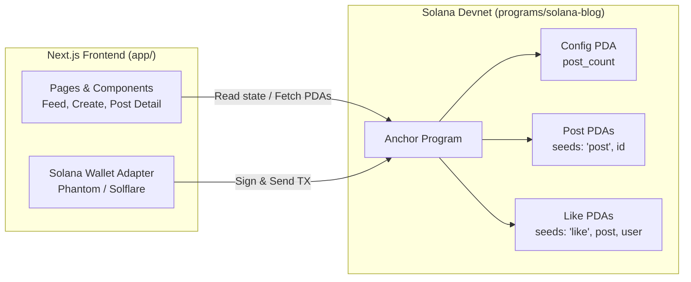

# Solana Blog — Documentation Guides

Welcome to the documentation guide for **Solana Blog**, a decentralized, fully onchain blogging platform built with **Anchor (Solana)** and **Next.js 14**.

---

## 📚 Guide Index

| Guide | Description |
|---|---|
| [**01. Getting Started & Starting the Project**](./01-getting-started.md) | Prerequisites, building/deploying the Anchor smart contract to Devnet, configuring `.env.local`, and starting the Next.js development server. |
| [**02. Using the App: From Wallet to Publishing**](./02-using-the-app.md) | How to connect a wallet, initialize the blog config, write & publish posts, read articles, and interact with onchain likes. |
| [**03. Architecture & Program Design**](./03-smart-contract-architecture.md) | Deep dive into Solana PDAs (`Config`, `Post`, `Like`), account layout, rent exemption, and program instructions. |
| [**04. Troubleshooting & FAQ**](./04-troubleshooting-and-faq.md) | Common errors (airdrop rate limits, simulation errors, "Program not configured", RPC limits) and their solutions. |
| [**05. Feature Testing & Verification Guide**](./05-feature-testing-guide.md) | Complete test matrix, automated test execution (`npm test`), interactive UI testing procedures, and edge cases. |

---

## 🗺️ System Overview

---

## ⚡ Quick Links
- **Smart Contract Code**: `programs/solana-blog/src/lib.rs`
- **Frontend Code**: `app/src/`
- **Anchor Configuration**: `Anchor.toml`
